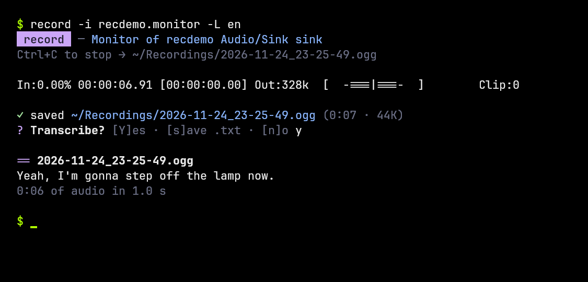

<div align="center">

# record

**Una grabadora de micrófono para tu terminal, con medidor de nivel en vivo.**<br/>
Hablas, presionas <kbd>Ctrl</kbd>+<kbd>C</kbd> y te ofrece convertir lo que dijiste en texto, sin internet, con [ross_transcribe](https://github.com/rossmelabasto/ross_transcribe).

[Instalar](#instalar) · [Uso](#uso) · [Cómo funciona](#cómo-funciona) · [Cambios](CHANGELOG.md) · [English](README.md)



</div>

## Qué hace

- **Medidor de nivel en vivo.** Ves la entrada mientras grabas, así sabes que el micrófono te está captando.
- **Ctrl+C y listo.** Al parar te pregunta: transcribir en pantalla, guardar un `.txt` con marcas de tiempo, o nada.
- **Manos libres (`-s`).** Empieza a guardar cuando hablas y para tras unos segundos de silencio.
- **Limpieza (`-c`).** Quita el ruido grave y normaliza el volumen justo al terminar.
- **Tu formato.** `ogg` (por defecto), `flac`, `wav` o `mp3`, con duración máxima opcional (`-d`).
- **Cualquier fuente.** Usa el micrófono por defecto de PipeWire; `-l` lista las fuentes y `-i` elige una.
- **Para scripts.** `-n` graba sin preguntar nada, para scripts y atajos. La carpeta sale de `RECORD_DIR`.
- **Privado.** Grabación y transcripción corren en tu computadora. Sin cuentas ni subidas.

## Instalar

### Desde el repositorio (Linux)

Paquetes firmados para pacman (CachyOS, Arch), APT (Ubuntu, Debian) y DNF (Fedora). Agrega el repositorio
una vez ([instrucciones](https://repo.rossmel.com/repository/)) y luego:

```bash
sudo pacman -S ross-record        # CachyOS, Arch
sudo apt install ross-record      # Ubuntu, Debian
sudo dnf install ross-record      # Fedora
```

Para las transcripciones instala también [`ross-transcribe`](https://repo.rossmel.com/transcribe/) (ya trae `record` consigo).

### Desde el código

`record` es un solo script de Bash. Necesita [SoX](https://sourceforge.net/projects/sox/) con entrada PulseAudio (la sirve PipeWire), `pactl` y Perl:

```bash
curl -fsSLo ~/.local/bin/record https://raw.githubusercontent.com/rossmelabasto/ross_record/main/bin/record
chmod +x ~/.local/bin/record
```

## Uso

```bash
record                          # graba hasta Ctrl+C y elige: transcribir, guardar un .txt o nada
record -s -t idea               # empieza al hablar, para tras 3 s de silencio, transcribe en pantalla
record clase-redes -c -o        # limpia el audio y guarda la transcripción al lado
record -d 1:00 -L es            # graba exactamente un minuto, transcripción en español
record -l                       # lista micrófonos; -i <nombre> elige uno
```

`record -h` muestra todas las opciones. Las grabaciones van a `~/Recordings/AAAA-MM-DD_HH-MM-SS[_nombre].ogg`, o a la carpeta de `RECORD_DIR`.

## Cómo funciona

1. La fuente se obtiene con `pactl get-default-source` (el dispositivo "default" de SoX no siempre ve el de PipeWire) y SoX la graba en mono, mostrando su medidor.
2. Con `-s`, el efecto `silence` de SoX solo guarda por encima del 1 % y para tras `SEC` segundos por debajo.
3. Con `-c`, la toma pasa por `highpass 80` (quita el ruido grave) y `norm -1` (normaliza a −1 dB).
4. La transcripción, si la quieres, la hace [`transcribe`](https://github.com/rossmelabasto/ross_transcribe): faster-whisper local, sin red después de bajar el modelo la primera vez.

## Licencia

[MIT](LICENSE) © Rossmel Abasto. `record` nació dentro de [ross_transcribe](https://github.com/rossmelabasto/ross_transcribe) y pasó a ser un proyecto propio en la 0.1.0.
