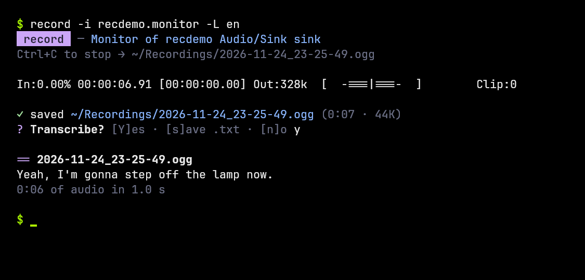

<div align="center">

# record

**A microphone recorder for your terminal, with a live level meter.**<br/>
Talk, press <kbd>Ctrl</kbd>+<kbd>C</kbd>, and it offers to turn what you said into text — offline, with [ross_transcribe](https://github.com/rossmelabasto/ross_transcribe).

[](https://github.com/rossmelabasto/ross_record/actions/workflows/ci.yml)
[](LICENSE)


[Install](#install) · [Usage](#usage) · [How it works](#how-it-works) · [Changelog](CHANGELOG.md) · [Español](README.es.md)



</div>

## Features

- **Live level meter.** See the input while you record, so you know the mic is actually picking you up.
- **Ctrl+C and done.** When you stop, it asks: transcribe on screen, save a `.txt` with timestamps, or nothing.
- **Hands-free (`-s`).** Starts saving when you speak and stops after a few seconds of silence.
- **Clean-up (`-c`).** Removes low rumble and normalizes the volume right after recording.
- **Your format.** `ogg` (default), `flac`, `wav` or `mp3`, with an optional maximum length (`-d`).
- **Any source.** Uses PipeWire's default microphone; `-l` lists the sources and `-i` picks one.
- **Scriptable.** `-n` records without asking anything, for scripts and hotkeys. The folder comes from `RECORD_DIR`.
- **Private.** Recording and transcription run on your computer. No accounts, no uploads.

## Install

### From the repository (Linux)

Signed packages for pacman (CachyOS, Arch), APT (Ubuntu, Debian) and DNF (Fedora). Add the repository
once ([instructions](https://repo.rossmel.com/repository/)), then:

```bash
sudo pacman -S ross-record        # CachyOS, Arch
sudo apt install ross-record      # Ubuntu, Debian
sudo dnf install ross-record      # Fedora
```

For transcripts, also install [`ross-transcribe`](https://repo.rossmel.com/transcribe/) (it already brings `record` with it).

### From source

`record` is one Bash script. It needs [SoX](https://sourceforge.net/projects/sox/) with PulseAudio input (served by PipeWire), `pactl` and Perl:

```bash
curl -fsSLo ~/.local/bin/record https://raw.githubusercontent.com/rossmelabasto/ross_record/main/bin/record
chmod +x ~/.local/bin/record
```

## Usage

```bash
record                          # record until Ctrl+C, then choose: transcribe, save a .txt or nothing
record -s -t idea               # start when you speak, stop after 3 s of silence, transcribe on screen
record networks-class -c -o     # clean up the audio and save the transcript next to it
record -d 1:00 -L en            # record exactly one minute, English transcript
record -l                       # list microphones; -i <name> picks one
```

| Flag | What it does |
|---|---|
| `-s [SEC]` | Start when there is sound, stop after `SEC` seconds of silence (default 3) |
| `-d DUR` | Maximum duration: seconds or `m:ss` |
| `-c` | Clean up afterwards: remove low rumble and normalize volume |
| `-f FMT` | Format: `ogg` (default), `flac`, `wav`, `mp3` |
| `-i SOURCE` | PipeWire source (default: the system one; see `-l`) |
| `-l` | List available sources |
| `-L LANG` | Spoken language for the transcript: `auto` (default), `es`, `en`… |
| `-t` | Transcribe when done, without asking (on screen) |
| `-o` | Transcribe when done and save a `.txt` with timestamps |
| `-n` | Don't transcribe or ask |
| `-V` | Show the version |

Recordings go to `~/Recordings/YYYY-MM-DD_HH-MM-SS[_name].ogg`, or to the folder in `RECORD_DIR`.

## How it works

1. The source is resolved with `pactl get-default-source` (SoX's own "default" device doesn't always see PipeWire's default) and SoX records it in mono, showing its live meter.
2. With `-s`, SoX's `silence` effect only starts saving above 1 % and stops after `SEC` seconds below it.
3. With `-c`, the take goes through `highpass 80` (removes rumble) and `norm -1` (normalizes to −1 dB).
4. The transcript, if you want it, comes from [`transcribe`](https://github.com/rossmelabasto/ross_transcribe): local faster-whisper, no network after the first model download.

## License

[MIT](LICENSE) © Rossmel Abasto. `record` started inside [ross_transcribe](https://github.com/rossmelabasto/ross_transcribe) and became its own project in 0.1.0.
